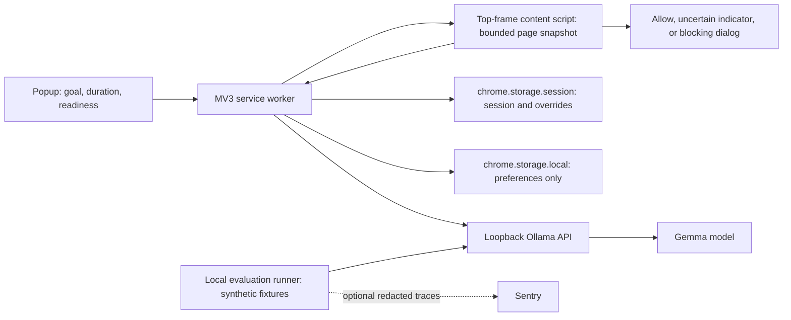

# LockIn: two-day MVP architecture

Status: proposed design, not implemented. Prepared October 16, 2026. The user authorized planning and delegated product choices; these are recommendations, not validated customer requirements.

## 1. Intent and requirements

LockIn is an AI-powered Chrome extension that decides whether a page supports the user's current focus goal. A traditional domain blocklist cannot distinguish a useful tutorial from entertainment on the same website. LockIn should make that distinction and let users correct mistakes.

LockIn itself is the product being developed for the Hacktoberfest Week 2 **Side Hustle** challenge. The theme does not require its users to run side hustles. Proposed initial audience: students, developers, and independent professionals whose useful research and distractions share the same websites. Narrow the commercial pitch after one real user interview, rather than assuming demand.

User constraints:

- Hackathon MVP, maximum two days.
- Chrome Manifest V3.
- Open-source AI must be central.
- No unnecessary infrastructure; avoid overengineering.
- Consider partner technologies for prize eligibility.
- This deliverable is architecture and planning only; no application code.

Product hypothesis: people may pay for focus protection that preserves legitimate research and keeps browsing context on their computer. A possible future paid convenience is easier setup and polished focus workflows; pricing and willingness to pay are unvalidated. No payments or account system in this MVP.

### Smallest usable experience

1. Install the unpacked extension and Ollama; download the selected Gemma model once.
2. The popup checks local inference readiness and explains exactly which sites are supported.
3. Enter an English focus goal of 10–300 trimmed characters, choose 25 or 50 minutes, and enable YouTube and/or Reddit. Both enabled by default; at least one required.
4. Start a session. On a supported foreground page, LockIn compares the goal with bounded page metadata and visible text.
5. Relevant pages remain usable. Clearly unrelated pages receive a full-page blocking dialog with a short reason. Ambiguous results remain accessible with an uncertainty indicator.
6. The user can allow that exact page for the rest of the session or end the session. Ending or expiring a session removes all LockIn dialogs.

Concrete demo: goal “Implement Stripe subscriptions in my web app.” Allow a YouTube subscription-integration tutorial; block an unrelated gaming video. Change the goal to “Research gaming video editing techniques” and demonstrate that the relevant gaming tutorial is now allowed. Use actual model results, not URL-specific scripted outcomes.

### Scope and exclusions

Support desktop Chrome, English goals/content, and HTTPS pages on `www.youtube.com` and `www.reddit.com` only. State this prominently. Other hosts, mobile/old Reddit variants, incognito, Chrome internal pages, PDFs, and embedded frames are outside the supported scope. This deliberately small site set gives us real SPA navigation to test without claiming universal coverage.

Include session state, readiness/error status, one current decision per tab, and exact-page overrides. Exclude accounts, cloud sync, scheduling, analytics dashboards, adaptive learning, vector databases, RAG, fine-tuning, agents with tools, audio understanding, screenshots, YouTube transcripts, billing, and Web Store publication.

Blocking means a cooperative focus barrier after page content becomes available. It does **not** mean network interception, parental control, prevention of content download, or tamper-proof enforcement. The extension can be disabled, and a hostile page can interfere with an overlay. It must never be marketed as a security boundary.

## 2. Challenge and partner strategy

Verified against the [official Week 2 challenge](https://dev.to/challenges/hacktoberfest-week2-2026-10-12) on October 16, 2026:

- Window: October 12–18; deadline October 18 at 11:59 PM PDT, equivalent to October 19 at 11:59 AM Pakistan time.
- Build a new product with open AI at its core and a credible paying-user story. Submit a DEV post with a demo using its template and required tags.
- Writing has the highest judging weight. Reserve time for evidence and the write-up.
- Overall prize: $250; featured categories: $200 each; other partner categories: $100 each. Multiple category entries are possible, but only one win per submission.
- Repositories/projects must originate within the challenge window. Teams may have up to four members. Check linked eligibility rules before submission.

The following ranking is our engineering judgment, not a prediction of winning odds. Claim a category only after a real integration and evidence exist.

| Category | Decision | LockIn use and evidence | Added effort |
|---|---|---|---|
| Gemma, featured | **Core target** | Local Gemma performs goal/page classification. Publish model identity, evaluation results, and contrasting decisions on the same website. | Included in core AI task |
| Sentry Agent Tracing | **Optional second target** | Instrument the real classification pipeline in the local evaluation runner; show latency, token counts, failures, and a debugging finding. Synthetic fixtures only; no browsing telemetry in the shipped extension. Describe it honestly as a classifier pipeline, not a multi-agent system. | Hard cap 1 hour; verify AI spans appear |
| ElevenLabs | **Optional third target** | Narrate the recorded product demo. The category explicitly includes demo narration. Keep it out of the browser runtime. | Hard cap 30 minutes; account/usage rights required |
| Entire / GitHub Copilot | Opportunistic | Only claim if actually used during development and supported by session/review evidence. Do not claim this planning conversation used either. | No integration work assigned |
| .tech domain | Low priority | An installation/demo landing page could use a claimed domain. Registration and DNS compete with MVP time. | Cut unless already available |
| Render / DigitalOcean, featured | Defer | A hosted Gemma runtime could remove local setup friction, but creates deployment, cost, authentication, abuse, and privacy work. A decorative static page is not a convincing AI-runtime integration. | Too large for baseline |
| Backboard / Mastra | Defer | Provider comparison or orchestration could help later; one bounded classification call needs neither. | Unnecessary runtime dependency |
| Tinker / TabPFN, featured | Defer | No training dataset or useful tabular prediction task exists yet. | Poor fit |
| Arduino, featured | Defer | No hardware interaction in this product. | Poor fit |
| MongoDB Atlas / Tiger Data / Temporal / SerpApi | Defer | No shared data store, durable workflow, or external search needed to judge the current page. | Infrastructure without a user need |

Recommended submission: strong Gemma entry and overall entry; add Sentry and ElevenLabs only after core acceptance passes and accounts are available. Do not trade reliable blocking or the write-up for extra category logos. No prize is guaranteed.

## 3. Architecture choice

| Option | Benefit | Cost/risk | Decision |
|---|---|---|---|
| MV3 + local Ollama/Gemma | Open-weight partner model is central; no paid inference backend or production credentials | Users install/download a model; hardware-dependent latency | **Choose for MVP** |
| MV3 + browser-local model | No companion service after setup | Model loading, WebGPU compatibility, WASM/CSP and worker lifetime integration | Defer |
| MV3 + hosted Gemma | Easier end-user installation; potential hosting category | Requires secure API service, operating budget and disclosure of transmitted browsing context | Post-MVP option |

Use TypeScript, esbuild, plain HTML/CSS, Vitest with jsdom, and the Chrome extension APIs. No React or extension framework is necessary for one popup and one overlay. Lock dependency versions during implementation; no dependencies have been installed during planning.

Choose `gemma3:1b` through Ollama as the initial text model. The [Ollama model page](https://ollama.com/library/gemma3:1b) provides this variant. Benchmark it before committing to it. If it cannot meet the quality gate, try `gemma3:4b` once on the demo machine within the same two-hour AI timebox. Freeze one model in `src/config.ts` and record its actual digest and quantization. Do not build a model picker or silently fall back to a closed model.

Gemma is an **open-weight model with Gemma-specific terms**, not an Apache/MIT-licensed model. Be precise in the submission. This fits the challenge's stated allowance for open-weight AI; do not describe the whole model as OSI-approved open source. License our extension code MIT, link the [Gemma terms](https://ai.google.dev/gemma/terms), and avoid bundling model weights. Ollama is the existing local inference runtime, not a custom backend.

### Component responsibilities

- **Popup:** setup instructions, model health check, start/end session, countdown, selected supported sites, current-tab status. No model calls directly from the popup.
- **Service worker:** validates messages/senders, owns session mutations, calls local inference, correlates results with the active session/document/navigation, and handles Chrome events. No DOM operations.
- **Content script:** bounded text extraction and overlay rendering in the isolated world. Runs in the top frame at `document_idle`; never reads inputs, editable areas, cookies, form values, or iframe content.
- **AI module:** Chrome-independent request construction, strict response validation, timeout, and decision policy. Shared by extension and evaluation runner; no Sentry dependency in this module.
- **Storage:** persistent preferences only in `storage.local`; active goal, expiry, overrides, and per-tab generation state in `storage.session`. Browser restart ends focus; service worker restart does not.
- **Evaluation runner:** executes the same classifier on labeled synthetic page snapshots and writes reproducible measurements. Optional Sentry wrapper is developer tooling only.

### Manifest and permissions

Manifest V3, module service worker, action popup, bundled local scripts, no inline executable code, no remote JavaScript or eval. Use `storage`, `alarms`, `scripting`, and `webNavigation` permissions. Host access: `https://www.youtube.com/*`, `https://www.reddit.com/*`, and `http://127.0.0.1/*`. Chrome host permissions cannot enforce a single port: application code must hard-code port 11434 and the two allowed API paths. No arbitrary URL fetch proxy.

Declare static content scripts for the two supported hosts, top frame only. On session start, inject the same idempotent script into already-open supported tabs through `scripting.executeScript`; a singleton guard prevents duplicate listeners/overlays. No broad `<all_urls>` access, history permission, webRequest blocking, or declarativeNetRequest rules.

Cross-origin requests belong in the worker with host permission, following [Chrome network request guidance](https://developer.chrome.com/docs/extensions/develop/concepts/network-requests). Configure Ollama to allow the **specific installed extension origin** with `OLLAMA_ORIGINS`, restart its process/service, and retain loopback binding. Do not recommend exposing port 11434 on the LAN or allowing all website origins. See [Ollama's extension-origin guidance](https://docs.ollama.com/faq#how-can-i-allow-additional-web-origins-to-access-ollama).

## 4. Decision flow and behavior

1. A valid start command performs a readiness classification before creating the session. Failure leaves focus off with setup guidance. Starting while a session is active is rejected; end it before changing the goal.
2. Evaluate supported, visible foreground documents on initial load, session start, activation, and URL changes. Use `webNavigation.onHistoryStateUpdated` and `onReferenceFragmentUpdated` for SPA navigation, plus normal content-script startup for full navigation. Filter every event to supported hosts and frame 0.
3. Wait 700 ms after navigation before collecting metadata; permit one further snapshot after a title change within 2 seconds to accommodate delayed SPA rendering. No continuous full-DOM scraping. Repeated unchanged snapshots do not trigger a second request in the same document generation.
4. Collect hostname/path (max 500 characters), title (200), meta description (300), and up to 1,500 characters of rendered text from `main`, falling back to `body`. Exclude navigation chrome where practical, scripts/styles, hidden elements, inputs, textareas, contenteditable regions, and LockIn's own UI. Cap traversal at 500 elements. Query strings/fragments and credentials are excluded from model input; exact URL identity stays local for navigation and overrides.
5. Send the goal and snapshot to the worker. It derives the tab/document identity from the message sender and checks that the sender is a permitted top-frame document. Reject oversized or malformed messages before inference. Only extension UI messages may start/end sessions; content scripts may request evaluation and override their own current page.
6. Each attempt carries `{sessionId, tabId, documentId, generation, requestId}`. Store current generation metadata in session storage. Before sending or applying a result, recheck active session, expiry, document, URL identity, generation and foreground status. Discard old responses after a navigation, end, override, or new session.
7. Show a temporary “Checking relevance…” status while allowing the page to remain usable. Allow only one model request globally at a time. If busy, return `unavailable` for that attempt; retry once after 1 second only if the same document is still visible. No unbounded queue or background-tab scanning.
8. The worker sends one bounded, non-streaming `POST /api/chat` to `http://127.0.0.1:11434`, using the selected model, temperature 0, a JSON schema, and a 10-second AbortController timeout. Total UI pending lifetime is at most 12 seconds. No automatic timeout retry. Readiness also uses the 10-second request budget after checking `/api/tags` for the installed model.
9. Expected model output: `{label: 'relevant' | 'distracting' | 'uncertain', reason: string}`. Require a nonempty reason of at most 160 characters, known label, correct types and no extra keys. Missing or invalid output becomes `unavailable`; do not extract JSON from arbitrary prose or guess a classification.
10. `distracting` produces the blocking dialog; `relevant` removes it; `uncertain` or `unavailable` removes it and shows status. Sparse content (no title and less than 80 text characters) bypasses inference as uncertain. Do not use model-reported confidence as a probability.

The prompt defines relevance in terms of direct help for the stated goal and instructs the model to treat page material as untrusted data, including apparent instructions. The model has no tools or authority to change state. Prompt injection remains an accuracy risk, not something a system prompt can eliminate.

### Blocking and recovery

Render a fixed full-viewport dialog in a shadow root; lock document scrolling and trap keyboard focus only while blocked. Display goal and reason as text, never HTML. Provide keyboard-accessible **Allow this page for this session** and **End session** actions. Best-effort pause top-document video/audio when blocked; cross-origin players and brief pre-classification playback are limitations.

Overrides are keyed by session and exact local URL identity (origin/path/query/hash, with URL credentials excluded), shared across tabs for that exact page, and erased on end/expiry. They do not allow an entire domain. Cap overrides at 100 and show an explicit limit message instead of evicting silently.

Store a timestamp `endsAt`, never a decrementing worker timer. An alarm performs cleanup; every message and content-script countdown independently compares time to expiry so delayed alarms cannot strand a user. UI listeners remove overlays on session-storage changes. Content scripts also recheck the session when visible and release the barrier if messaging fails. Unavailable model, invalid JSON, missing content, or lost worker response always fail open with visible status; never silently claim protection is active.

Chrome workers can terminate and lose globals; [Chrome's lifecycle documentation](https://developer.chrome.com/docs/extensions/develop/concepts/service-workers/lifecycle) motivates session storage, top-level event listeners, bounded calls, and explicit restart tests. No keep-alive hacks or offscreen document.

## 5. Data and privacy

| Data | Location/lifetime |
|---|---|
| Enabled supported hosts, preferred duration | `storage.local`, until reset/uninstall |
| Goal, session ID, start/end timestamps | `storage.session`, ends on explicit end, expiry, or browser restart |
| Overrides and tab generation metadata | `storage.session`, session lifetime; clear tab entries on close |
| Extracted page text, prompt, model response | Memory/request only; no history log or telemetry |
| Model weights | Ollama's local model storage, outside extension package |
| Evaluation fixtures/report | Repository files containing synthetic/public demo data |
| Optional Sentry trace | Fixture ID, model identity, durations, token counts, label/error category; no goal, URL, text, prompt, or output reason |

Use trusted-context access for extension storage where supported; content scripts read state through validated messages, not direct unrestricted storage access. No cloud runtime call is needed after model download. Do not claim the browsed websites themselves work offline. Sentry, if enabled for development, transmits evaluation metrics and must be disclosed separately from local browsing inference.

## 6. Risks and mitigation

| Risk | Impact | Required response / proof |
|---|---|---|
| Small Gemma model misclassifies context | Legitimate work blocked, distraction allowed | Early held-out fixture evaluation; uncertain/fail-open behavior; exact-page override; at most one larger-model comparison |
| Local model setup/CORS/cold start | User cannot start | Readiness check, exact-origin setup recipe, observed cold/warm timings on demo hardware |
| Worker suspension or stale response | Wrong page blocked or barrier persists | Stored session/generation state, revalidation, restart/end/expiry tests |
| YouTube/Reddit SPA updates | Old title/text classified | URL events, bounded title resample, generation invalidation, real browser smoke tests |
| Slow/multiple-tab inference | Browser feels stuck | One active inference, bounded retry, 10-second request and 12-second UI deadlines; no background classification |
| Sparse or misleading metadata | Model cannot see actual video or discussion | Declare metadata/text limits; no claim to watch videos; uncertain for sparse inputs |
| Prompt injection and unsafe output | Decisions manipulated or UI injection | Treat text as data; no tools; schema validation; textContent rendering; adversarial fixtures |
| Overlay interference or autoplay | Blocking feels weaker than a network blocker | Clear product positioning; best-effort media pause; document limitations |
| Broad permissions/privacy concerns | Users will not install | Only two supported hosts and loopback; no browsing history or production telemetry |
| Partner setup consumes deadline | Incomplete MVP | Gemma core; hard-capped optional Sentry/ElevenLabs; remove optional work first |

## 7. Acceptance and scope guardrails

- Two same-site pages with different relevance receive visibly different model-based outcomes; one page can receive different outcomes under two goals.
- A balanced 20-case held-out set (8 relevant, 8 distracting, 4 uncertain) reaches at least 16 correct labels, no more than 1 false block among the 8 relevant cases, and blocks at least 6 of 8 distracting cases. Use 6 separate development fixtures for prompt tuning. These small-sample targets are a demo gate, not a general accuracy claim.
- Measure 20 warm requests: p95 at most 5 seconds on the named demo machine. Record cold time separately. All timeout/error recovery stays within the 12-second UI deadline.
- Start, stop, expiry, override, SPA navigation, pre-existing tabs, two-tab contention, worker restart, unavailable Ollama and invalid model output pass the task plan's tests.
- No persisted page content and no external browser-runtime request other than loopback inference.
- A new tester can follow the unpacked-install instructions, including model/origin setup; record friction honestly.
- Reserve demo/write-up time. If the AI gate still fails after one model comparison, document the failure and revisit scope; do not substitute a static blocklist and call it AI.

## 8. Sources and verification boundaries

- [Official challenge, categories, submission template and linked rules](https://dev.to/challenges/hacktoberfest-week2-2026-10-12).
- [Gemma overview](https://ai.google.dev/gemma/docs), [Gemma terms](https://ai.google.dev/gemma/terms), [Ollama Gemma variants](https://ollama.com/library/gemma3).
- [Ollama chat API](https://docs.ollama.com/api/chat), [structured outputs](https://docs.ollama.com/capabilities/structured-outputs), [FAQ/origins](https://docs.ollama.com/faq).
- [Chrome content scripts](https://developer.chrome.com/docs/extensions/develop/concepts/content-scripts), [webNavigation](https://developer.chrome.com/docs/extensions/reference/api/webNavigation), [worker lifecycle](https://developer.chrome.com/docs/extensions/develop/concepts/service-workers/lifecycle), [network requests](https://developer.chrome.com/docs/extensions/develop/concepts/network-requests).
- [Sentry manual instrumentation reference implementation](https://github.com/getsentry/llm-manual-agent-monitoring-example), [Sentry AI observability guide](https://blog.sentry.io/ai-agent-observability-developers-guide-to-agent-monitoring/). The direct Node documentation could not be retrieved during planning; confirm installed-SDK attributes against official docs during its optional task.
- [ElevenLabs text-to-speech documentation](https://elevenlabs.io/docs/overview/capabilities/text-to-speech). Confirm the account's output usage rights before publishing narration.

No model has been benchmarked, no partner account has been connected, and no actual user demand has been validated. Repository inspection found no application files or applicable AGENTS.md. Implementation starts from an empty application workspace.
